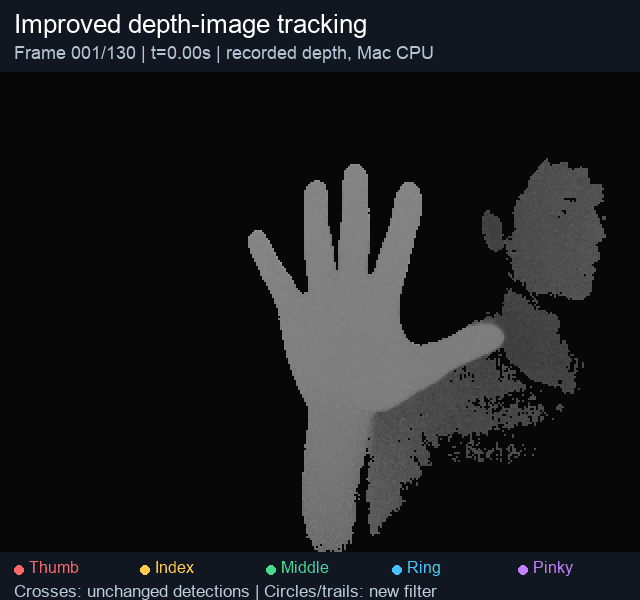

# DepthTrack

Portable depth-tree inference and responsive 3D point tracking, with a recorded hand demo, CPU/Metal/Mojo backends, and a small C API for mobile apps.

**[Open the browser demo](https://twerdster.github.io/depthtrack/)** · [Recorded outputs](docs/results.md) · [Native/mobile guide](docs/native-platforms.md) · [Inference backends](backends/README.md)

Native Tea forests have a separate [CPU inference and calibrated observation
guide](docs/tea-forest.md). This path loads feature-index trees with their exact
`Coords.co` files, averages per-tree probabilities, and supports complete deep
forests. [Selected HandNet models and results](docs/tea-forest.md#trained-handnet-models)
provide a three-tree ensemble and a single tree with 20 decisions, explicit
learned background and verified Mac/Linux CPU inference. These models are separate
from the historical detector and browser recording below.



The demo contains130 real recorded depth frames spanning17.6s. Crosses are learned fingertip detections; circles and trails are the new tracker. The browser actually computes the causal tracker from the recorded observations. It does not run a neural network or capture a camera. [Compare the original and improved output](docs/media/comparison_frame_066.png).

## What is included

- A dependency-free C++17 tracking core with C ABI, a NumPy reference and matching JavaScript implementation. They use timestamps in seconds and XYZ in millimetres; missing, held and lost states remain explicit.
- Self-contained seven-class ten-split depth-tree inference on C++ CPU, macOS Metal and Mojo V3/Spartan-6, including the compact model, six numerical fixtures, RTL, transport, reviewed bitstream and actual result evidence.
- A separate optional OpenCV restoration of the full-depth historical ZScanV02 hand/fingertip detector, plus the original tracking baseline. Its two large archived models remain external.
- Native Swift and Kotlin/JNI integration examples, a phone-friendly static viewer, lossless numeric sample depth, and recorded tracking outputs. No camera SDK, proprietary compiler installer or account is required for sample replay.

The tracker is generic per-point code: five fixed fingertip classes are the sample application. Supply observations from another calibrated detector or sensor to track other semantic3D points.

## Run on each platform

| Platform | Run path | Verified scope |
| --- | --- | --- |
| **Mac** | Python or C++ replay below; `python3 backends/validate.py --cpu --metal`; browser demo | Native tracker,650 full-state golden checks, CPU98,304pixels/variant, actual Metal GPU, optional OpenCV detector build |
| **Linux** | Same Python/CMake commands; CPU inference; Icarus FPGA simulation | Native unit/C API/full-state checks executed on x86-64 Linux; additional clean-checkout CI covers the package |
| **iOS** | Open browser demo in Safari, or link the C library using [Swift example](examples/swift/README.md) | arm64 device and simulator static-library cross-builds; Swift type-check. No iPhone app/device execution claimed |
| **Android** | Open browser demo in Chrome, or build the C API/JNI with the [NDK example](examples/android/README.md) | arm64 JNI cross-build passed in CI; JavaScript parity and responsive desktop-browser QA. Kotlin/app/device runtime is untested |
| **FPGA** | [Mojo V3 build/program/host guide](backends/fpga/README.md); host performs temporal tracking | Ten-split128×128 inference previously executed on physical50MHz Mojo; packaged RTL simulation rechecked. Full hand detector/tracker is not implemented in FPGA fabric |

The browser viewer works without Python or native compilation once hosted. Native mobile examples consume XYZ observations; they are integration fragments, not complete signed apps or camera acquisition pipelines. The C++ packed inference header can also be embedded in native apps; the supplied Swift/JNI wrappers expose tracking.

### Mac and Linux: tracking replay

```sh
git clone https://github.com/twerdster/depthtrack.git
cd depthtrack
python3 -m venv .venv
source .venv/bin/activate
python -m pip install -e .
depthtrack replay samples/handmesh/tracking_fixture.json --verify --output out/tracks.json
```

Expected:130frames,635 visible outputs,634 accepted observations, one explicitly held jump, zero difference from the saved Python reference. The15 initial missing class observations remain missing.

Or build the dependency-free C++ library/CSV executable with CMake3.20+ and a C++17 compiler:

```sh
cmake -S . -B build/native -DCMAKE_BUILD_TYPE=Release
cmake --build build/native --parallel 4
ctest --test-dir build/native --output-on-failure
build/native/depthtrack_csv samples/handmesh/tracking_fixture.csv out.csv
```

CSV's first seven columns are `frame,time_s,class_id,has_observation,x,y,z`; additional golden columns in the sample are ignored. Use one persistent tracker per semantic point, call it once per strictly increasing timestamp, and supply missing observations explicitly. [C header](include/depthtrack/depthtrack.h) · [Python API](python/depthtrack/tracker.py).

```python
from depthtrack import AdaptivePointTracker
tracker = AdaptivePointTracker()
state = tracker.update(0.0, [10, 20, 350])
state = tracker.update(0.13, None)  # held/lost is distinguished from a measurement
```

### Browser, iOS and Android replay

```sh
python3 -m http.server 8000 --directory web
```

Open `http://localhost:8000`. For a phone on the same reachable LAN, serve with `--bind 0.0.0.0` and use the host's LAN address, or use the [hosted HTTPS demo](https://twerdster.github.io/depthtrack/). No account, Tailscale, camera permission or CDN is needed. Play/pause, scrub the real timestamps, and switch between original, improved and comparison views. Serving is required; `file://` cannot fetch the JSON/modules reliably. See [viewer guide](web/README.md).

For native builds, follow the exact [iOS CMake/Swift](docs/native-platforms.md#apple-platforms) and [Android NDK/JNI](docs/native-platforms.md#android-ndk-and-jni) commands. The device must supply calibrated XYZ observations in millimetres and a monotonic clock in seconds. Camera capture/depth backprojection is a separate adapter; an ordinary RGB frame is not a metric depth frame.

### CPU, Mac GPU and FPGA tree inference

```sh
# No serial or device access:
python3 backends/validate.py --cpu
python3 backends/validate.py --cpu --metal   # macOS with a real Metal device
python3 backends/fpga/sim/run.py --all-fixtures --uart  # requires Icarus Verilog
```

These validate the resident128×128 **ten-split seven-class model**, not the full-depth two/nine-class detector used for the tracking recording. All98,304 labels and reached heaps agree on the six fixtures. The compact model uses1,023nodes and1,024leaves; depth0 returns background7 and unknown/no-vote remains255. Physical use is explicit and requires the correct board/port; ordinary tests never open serial. [Physical instructions, image hash and ISE rebuild](backends/fpga/README.md).

The preserved original benchmark was2.56ms literal CPU,1.125ms optimized CPU,0.038ms Metal device kernel, and8.44ms FPGA core on a dense128×128 frame. FPGA stop-and-wait USB transport was~16.38s/frame. These are historical measurements with different timing boundaries, not a new portable benchmark or an FPGA speedup. [Measurement evidence and limits](backends/evidence/prior_baseline.json).

## Tracking result and limits

The new filter uses a shared XYZ speed-adaptive [1€ low-pass](https://gery.casiez.net/1euro/), actual timestamp intervals, immediate measured-position initialization, bounded holds, conservative jump rejection and explicit reacquisition. It avoids the original zero-posterior initialization and repeated self-measurement on unmatched frames. It is causal and uses no future observations. Default parameters and status policies are public.

On477 common visible outputs,95th-percentile distance to the same current detections drops116.82→15.37mm. On373 samples where the original tracker was freshly matched, it drops28.94→11.86mm. These measure detector-relative separation, **not anatomical ground-truth accuracy or measured latency**. Wrong upstream class/mode detections can remain; smoothing alone does not solve identity mistakes. Immediate initialization also changes availability compared with the original four-update maturity delay. [Full result scope](docs/results.md).

The old model training dataset and its relationship to **HandNet** are **unverified**. No training occurred here. HandMeshRecord supplied this demonstration sequence, and training/test independence is unverified. This project is linked from HandNet as a reusable related implementation, not as a reproduction of the HandNet neural network or its paper's evaluation.

## Tests and provenance

```sh
python tests/python/test_tracker.py
node --test web/tests/*.test.mjs
python3 tools/unpack_sample.py --output out/depth.u16
```

Native CTest checks lifecycle behavior, C-header compatibility and650 complete golden states including histories. JavaScript checks the same recording plus separate synthetic failure/motion cases. Python checks initialization, jitter, irregular cadence, missing data, spikes, relocation and prefix causality. Backend tests verify numerical outputs/heap traces/RTL counters, transport CRC/guards and UART responses. No tests infer recognition accuracy from implementation agreement.

The [recorded fixture](samples/handmesh/README.md), [optional original detector](legacy/zscan/README.md), [backend evidence](backends/evidence/), and [platform build report](docs/native-platforms.md) preserve source identities and validation boundaries. The numeric depth sample is lossless; its display atlas is8-bit contrast rendering and must not be used for inference. No full model archives or private records are required by the default checks.

[Clean-checkout CI run](https://github.com/twerdster/depthtrack/actions/runs/43712008750) passed Mac/Linux native and CPU checks, browser/Python parity, Linux FPGA simulation, iOS static cross-builds and Android JNIarm64 cross-compilation. The same run deployed the public demo. [Machine-readable CI record](docs/validation-ci.json).

Read [attribution and component notices](NOTICE.md); historical, vendor and sample terms remain separate. For maintenance, use [SUMMARY.md](SUMMARY.md) then [SKILL.md](SKILL.md).
