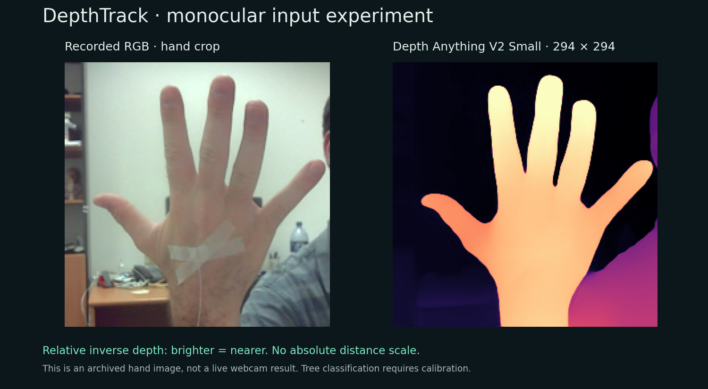

# Live monocular-depth experiment

[Open the experimental camera page](https://twerdster.github.io/depthtrack/live/).

This adds a new input adapter: RGB camera → Depth Anything V2 Small → approximately calibrated depth → the recovered seven-class, ten-split tree → per-class region observations → the existing causal tracker. It runs locally in the browser, including on compatible phone browsers. It does not involve a server receiving camera frames or an FPGA. Physical phone performance and anatomical accuracy remain unverified.

## Try it

1. Open the HTTPS page, select automatic GPU/CPU or CPU compatibility mode, and load the model. The first download includes the runtime and weights: approximately27MB for CPU q8,50MB for GPU fp16, or99MB for GPU fp32. Progress and failures are visible. Downloads come from jsDelivr and Hugging Face; no login is required.
2. Start the camera and allow camera permission. Choose front/webcam or rear before starting. Alternatively choose a local photo. The three panels always show the same captured frame; processing drops intervening frames instead of building a queue.
3. With a ruler, place the same flat hand/target in the centre box at the near distance and capture an anchor. Repeat at the far distance. Keep the camera, crop, subject and scene fixed. The default30/70cm values are instructions, not measured distances: enter the distances you actually use.
4. Choose a far cutoff and centre mask. Zero, invalid, too-near and too-far depth becomes background7. Results update locally; save the current three-panel PNG if useful. Stop releases camera tracks, as does hiding/leaving the page.

If model initialization or inference fails, reload it in CPU compatibility mode. HTTPS or localhost is required for camera access. `file://` and ordinary phone-to-LAN HTTP are unsuitable. A large neural model can run slowly on a phone; inference time and completed results/second are displayed separately. Camera capture rate is not inference throughput.

## Scale and interpretation

The selected model predicts **relative inverse depth**, not metres. We consume its floating `predicted_depth` tensor. We do not feed the separately min/max-normalized uint8 visualization into the tree.

For raw patch medians `r_near`, `r_far` and entered depths in metres, the two-anchor fit is `a=(1/z_near-1/z_far)/(r_near-r_far)`, `b=1/z_near-a*r_near`, then `z=1/(a*r+b)`. Near raw values must exceed far values; invalid/degenerate anchors and nonpositive inverse-depth denominators are rejected. Calibration is held across frames; relative depth is never independently normalized into millimetres each frame. Scene-dependent scale/shift drift can still invalidate the fit. This is approximate pseudo-metric depth, not an independent metric-depth measurement or an accuracy guarantee.

The tree was trained on sensor depth. Low-resolution monocular estimates can merge fingers, distort boundaries, and infer the wrong foreground. A distance cutoff removes pixels but cannot repair that geometry. The seven-class prefix has **no learned nonzero-depth background class**: every retained pixel gets a hand-part or unknown label, including non-hand objects. The manual centre mask is not foreground segmentation. This experiment intentionally displays the raw class regions so this failure mode remains visible.

Each of classes0–4 contributes the largest four-connected component with at least12pixels. Its mean backprojected XYZ is a **candidate region observation**, not the restored full-depth detector's fingertip mode. Projection assumes a60° horizontal field of view on the square crop, so lateral XYZ is approximate. One existing timestamp-aware tracker per class consumes these observations; missing/held/lost remain explicit. Smoothing does not establish correct anatomy or identity. Classes5/6 (palm/wrist) are displayed, not tracked.

This uses the compact ten-split HandPlugin tree, not the separate full-depth two/nine-class ZScan detector used in the recorded comparison. No training happened, and a connection between either recovered model and HandNet training remains unverified.

## Reproduce and maintain

Serve the repository's `web/` root, for example `python3 -m http.server 8000 --directory web`, then open `http://localhost:8000/live/`. For a phone use the hosted HTTPS page or another trusted HTTPS origin. The recorded viewer at `/` remains independent of this neural model/runtime.

- `web/live/model-worker.mjs` owns model loading/preprocessing/inference in a terminable worker. Transformers.js is pinned to3.8.1; the model revision is `4472b7362082ad9968fee890ca0f1e5aca36b93d`. Actual model input is asserted to be `[1,3,294,294]`, rather than assuming resizing the video makes inference smaller.
- `model-client.mjs` bounds load/inference time, propagates progress/errors and rejects overlapping work. `camera.mjs` has one job in flight and releases camera resources on stop/errors. No camera opens on page load.
- `tree.mjs` is an allocation-bounded exact port of the packed CPU inference arithmetic. All six fixtures,98,304labels and reached heaps, match the source backend; background remains7 and unknown255. `model/nodes.bin` and `leaves.bin` must remain byte-identical to `backends/model/depth10/`.
- `depth.mjs` contains the inverse-depth fit, resampling/gating, patch sampling and component observations. `../tracker.mjs` remains the shared tracker.
- Run `node --test web/tests/*.test.mjs web/live/tests/*.test.mjs`. Tests cover the numerical tree, calibration, masks, component adapter, model-client failures, and camera lifecycle/backpressure. These are separate from measured neural inference.

Source references: [Depth Anything V2](https://github.com/DepthAnything/Depth-Anything-V2), [relative inverse-depth clarification](https://github.com/DepthAnything/Depth-Anything-V2/issues/174), [pinned ONNX export](https://huggingface.co/onnx-community/depth-anything-v2-small/tree/4472b7362082ad9968fee890ca0f1e5aca36b93d), [Transformers.js3.8.1 implementation](https://github.com/huggingface/transformers.js/tree/3.8.1), [WebGPU runtime guidance](https://huggingface.co/docs/transformers.js/en/guides/webgpu). The upstream Depth Anything V2 Small/export terms are Apache2.0; preserve the existing recovered-tree notices. Neural weights and runtime are fetched, not vendored or relicensed here.

## Executed smoke evidence

On the Mac M3 Max, a fresh accountless Chrome session produced finite294×294 raw tensors from archived HandMeshRecord RGB hand images. WASMq8 first neural inference took785.4ms. WebGPUfp16 first inference took1184.1ms including initial compilation; subsequent repeated-image network calls settled around16–17ms (median16.2ms after the first follow-up). This is network-only development timing on repeated input, not full camera throughput, a phone result, or a controlled hardware benchmark. The illustration shows relative depth only; it does not claim calibrated tree recognition.

A separate real browser run with Chrome's synthetic camera processed3frames, stopped/released its track with no subsequent frame commits, restarted to6frames and released again without page errors. This exercises actual neural inference and camera scheduling, but the video source is synthetic. A bounded native physical FaceTime capture also succeeded and released the camera; its image was nearly black (gray range0–6), so no useful live hand scene or detection quality was demonstrated. No physical iOS/Android execution is claimed. Machine-readable scope/timings: [monocular-smoke.json](monocular-smoke.json).
