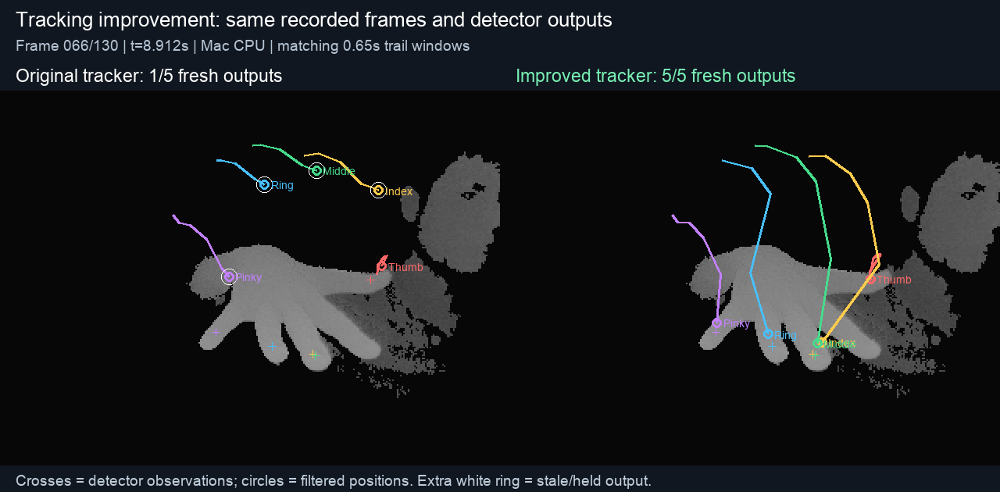

# Recorded outputs and measured scope

The [phone-sized improved GIF](media/improved_tracking_phone.gif) and [full before/after GIF](media/tracking_before_after.gif) contain all130 distinct chronological frames,17,710ms playback including the final-frame hold. They show a real saved depth recording, learned image detections and computed temporal output on Mac CPU. Both comparison panes use equal0.65s trails, the same projection, scale, timestamps and observations. Crosses are detections; circles are filtered states; an extra white ring means held/stale output.

The models were recovered from Aaron Wetzler's ZScanV02 hand/fingertip detector. The recording is HandMeshRecord,17.583466s of numeric millimetre depth. No magnetic positions or sensor-derived hand crops were supplied to detection/tracking. Actual camera calibration is source-supported, not independently revalidated. Model training provenance, HandNet membership and held-out status are unknown.

| Identical-observation comparison | Original | Improved |
| --- | ---: | ---: |
| P95 distance to current detection,477 common visible outputs |116.8245mm|15.3745mm|
| P95 distance on373 originally freshly matched samples |28.9411mm|11.8571mm|
| Fresh measured outputs among635 detections |373|634|
| Stale/held outputs |104|1|
| Frames with allfive fresh outputs |15|126|

Distances are against the same noisy detections, not anatomical ground truth. Availability includes a changed policy: the improved tracker initializes immediately, whereas the original waits four updates before displaying a mature finger. The new tracker retains one held thumb jump at frame49, with159.38mm separation from that observation. It is shown and marked rather than removed from the result.

Separate synthetic tests reduce stationary3D noise RMS6.8667→4.9010mm. On the specified synthetic moving path, adaptive filtering has9.0961mm RMS versus28.6355mm for a fixed1.2Hz filter. These test responsiveness/jitter behavior and do not establish real-recording accuracy; raw detections can be closer to synthetic truth than a smoothed result.

[Comparison JSON](../samples/handmesh/comparison.json) · [complete expected states](../samples/handmesh/tracking_fixture.json) · [native CSV](../samples/handmesh/tracking_fixture.csv) · [synthetic check record](../samples/handmesh/synthetic_validation.json).
